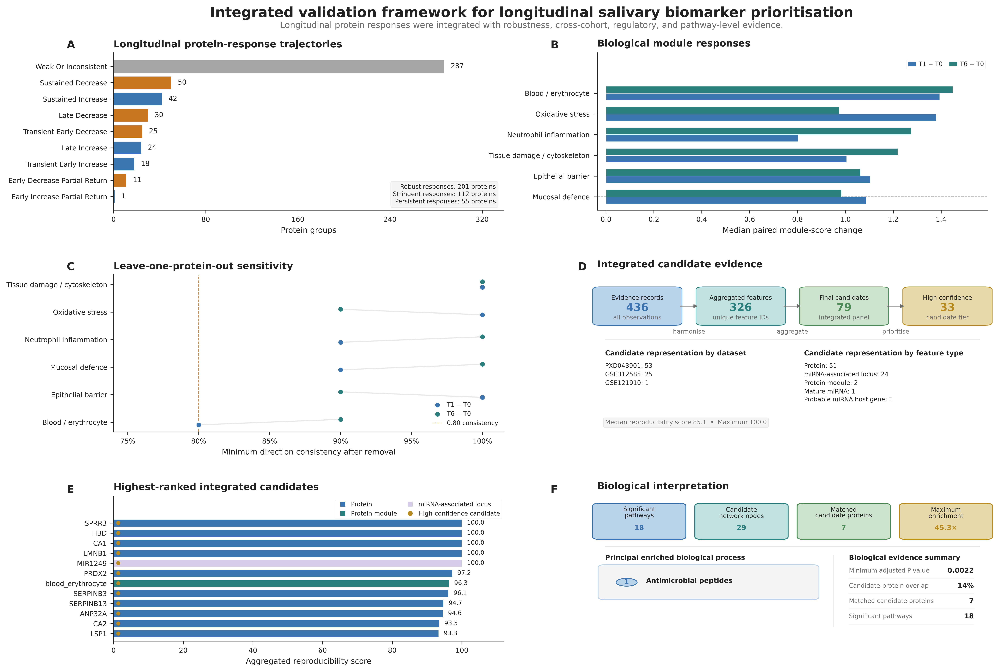
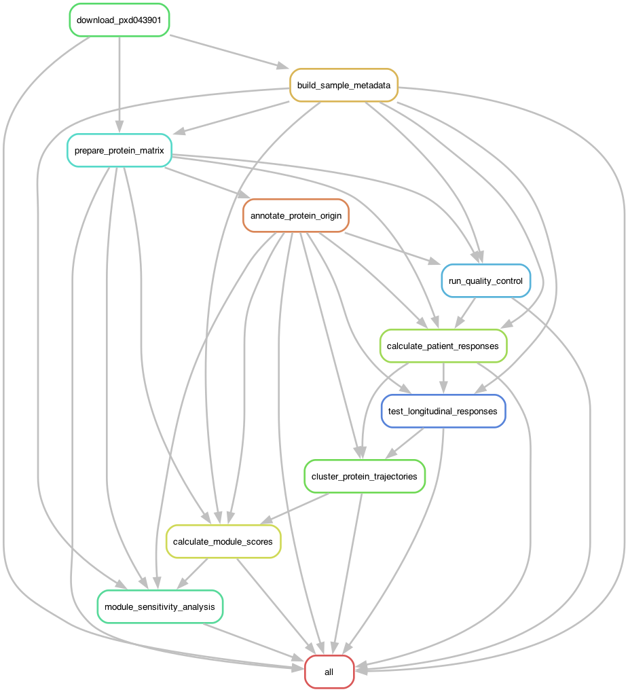

# Integrated multi-omics validation of salivary biomarker candidates in periodontitis

A reproducible analysis framework for prioritising salivary biomarker candidates by combining longitudinal proteomics, salivary miRNA evidence, extracellular-vesicle miRNA robustness, regulatory evidence, and pathway-level interpretation.

<p align="center">
  
</p>

## Overview

This repository evaluates salivary biomarker candidates using several complementary evidence layers rather than relying on a single differential-abundance result. The analysis includes:

- longitudinal protein responses after non-surgical periodontal treatment;
- patient-level consistency and formal longitudinal testing;
- predefined biological-module scoring and leave-one-protein-out sensitivity analysis;
- exploratory salivary miRNA evidence;
- donor-matched assessment of extracellular-vesicle miRNA method sensitivity;
- modality-aware evidence aggregation and candidate prioritisation;
- curated miRNA-target support, pathway enrichment, and candidate-network construction.

The repository was developed as a computational research project focused on multi-omics analysis of oral fluids.

## Scientific question

Which salivary molecular responses are reproducible across patients, robust to analytical choices, supported by independent molecular evidence, and biologically interpretable enough to justify further biomarker validation?

The workflow separates three concepts that are often conflated:

1. **Biological response evidence** — longitudinal or case-control molecular change.
2. **Technical robustness evidence** — sensitivity to sampling or extracellular-vesicle isolation method.
3. **Biological interpretation** — regulatory, pathway, and network support.

Scores from different evidence classes are therefore not treated as directly equivalent biological effect sizes.

## Data resources

| Accession | Modality | Role in this repository | Implemented analysis |
|---|---|---|---|
| `PXD043901` | Salivary proteomics | Primary longitudinal discovery dataset | Complete longitudinal proteomics workflow |
| `GSE121910` | Salivary miRNA expression | Exploratory disease-associated miRNA evidence | Table audit, curation, aggregation, and visualisation |
| `GSE312585` | Extracellular-vesicle miRNA sequencing | Technical robustness and method-sensitivity evidence | Donor-centred QC, paired method contrasts, feature classification, and consensus signature |
| `PXD043491` | Salivary proteomics | External validation resource registered for later cross-platform comparison | Source material retained; no completed result branch is claimed here |

### PXD043901 longitudinal design

The primary proteomics analysis contains 30 LFQ samples from 10 patients measured at three time points:

- `T0`: pre-treatment baseline;
- `T1`: one month after treatment;
- `T6`: six months after treatment.

The workflow downloads the deposited MaxQuant outputs, reconstructs sample metadata from the LFQ column names, prepares raw and log2-transformed protein matrices, annotates protein origin, performs quality control, calculates paired patient-level changes, tests longitudinal responses, classifies trajectories, and scores biological modules.

### GSE312585 technical design

The extracellular-vesicle miRNA analysis contains 12 samples from three donors processed using four isolation or preparation methods. Donor-centred analyses are used to distinguish method-sensitive features from features that remain comparatively stable across methods. This dataset contributes technical reproducibility evidence and is not interpreted as a periodontitis disease-direction dataset.

### GSE121910 exploratory miRNA evidence

The salivary miRNA branch audits and collapses the provided expression tables, retains sequence-level provenance, and generates exploratory candidate summaries and abundance visualisations. Because the source tables do not provide inferential p-values suitable for the integrated scoring framework, this branch is not assigned a formal direction-consistency component.

## Workflow

<p align="center">
  
</p>

The project is organised as a modular Snakemake workflow. The main workflow imports dataset-specific and integration rules from:

```text
workflow/
├── Snakefile
├── paths.smk
└── rules/
    ├── gse312585.smk
    ├── pxd043901_modules.smk
    ├── pxd043901_proteomics.smk
    ├── reporting.smk
    ├── screening.smk
    └── validation.smk
```

The primary proteomics branch follows this dependency structure:

```text
download_pxd043901
        ↓
build_sample_metadata
        ↓
prepare_protein_matrix
        ↓
annotate_protein_origin
        ↓
run_quality_control
        ↓
calculate_patient_responses
        ↓
test_longitudinal_responses
        ↓
cluster_protein_trajectories
        ↓
calculate_module_scores
        ↓
module_sensitivity_analysis
```

Independent small-RNA branches are subsequently harmonised through the evidence registry, candidate-prioritisation, regulatory-network, gene-set, pathway-enrichment, and candidate-network steps.

## Analysis components

### 1. Proteomic quality control

The `PXD043901` QC branch generates:

- detected proteins per sample;
- missing-value fraction per sample;
- LFQ intensity distributions;
- PCA coordinates and explained variance;
- sample-level Spearman correlation;
- sample and protein QC tables.

Generated figures are stored in:

```text
results/PXD043901/figures/qc/
```

### 2. Longitudinal protein responses

Patient-level changes are calculated for `T1 − T0` and `T6 − T0`. The workflow produces response summaries, ranked responses, formal longitudinal tests, stringent and preliminary robust-response tables, persistent-response tables, and trajectory classes.

The processed primary matrix contains 508 retained proteins. Across individual samples, 391–489 proteins were detected, and the median missing fraction was 0.098. Among proteins available in all ten paired comparisons, 270 were evaluable for `T1 − T0` and 262 for `T6 − T0`. The reproducibility-oriented screen retained 305 protein-response records.

These counts describe repository-derived analytical outputs and should not be interpreted as clinically validated biomarkers.

### 3. Biological-module analysis

Protein-level signals are aggregated into predefined modules stored in:

```text
config/biological_modules.csv
```

The module branch generates sample-level scores, patient-level response deltas, longitudinal statistics, module coverage, and leave-one-protein-out sensitivity estimates. The sensitivity analysis evaluates whether a module-level direction is preserved when each constituent protein is removed in turn.

### 4. Extracellular-vesicle miRNA method sensitivity

The `GSE312585` branch includes:

- raw count-matrix construction;
- miRNA filtering and log2-CPM transformation;
- library-size and detected-feature QC;
- PCA and hierarchical clustering;
- donor-centred method effects;
- all paired method contrasts;
- contrast-level robustness summaries;
- feature classification;
- a consensus method-sensitive signature.

The output explicitly distinguishes technical method sensitivity from biological disease evidence.

### 5. Evidence registry and candidate prioritisation

The integration layer harmonises heterogeneous evidence records while retaining their dataset, modality, feature type, evidence class, and provenance.

The prioritisation step scored 436 evidence records and retained a 54-record candidate panel containing:

| Feature type | Candidate-panel records |
|---|---:|
| Protein | 20 |
| Protein module | 12 |
| miRNA-associated locus | 20 |
| Mature miRNA | 1 |
| Probable miRNA host gene | 1 |

The scores quantify reproducibility-oriented evidence within each evidence class. Protein, module, mature-miRNA, miRNA-locus, and technical method-sensitivity scores are not interpreted as directly interchangeable biological quantities.

### 6. Regulatory and pathway interpretation

Candidate proteins and miRNA evidence are mapped through curated reference records, regulatory-target overlap, gene-set preparation, and enrichment analysis.

Under the stringent regulatory-edge filter used in the repository:

- 51 candidate protein nodes were eligible for target matching;
- 7 candidate proteins had experimentally supported database matches;
- 7 supported regulatory edges were retained in the unfiltered validated table;
- 0 edges met the stricter multi-database, multi-publication, strong-evidence threshold.

The absence of high-confidence edges under this filter is reported directly and is not interpreted as evidence that regulation is absent.

Pathway enrichment is performed against an explicitly prepared enrichment universe. Significant results are written separately from the complete enrichment table. The largest repository-derived fold enrichment was 45.33× for a two-gene Reactome term; such small-gene-set enrichments are retained for transparency but treated cautiously.

### 7. Candidate network

The candidate network integrates:

- protein or gene nodes;
- miRNA nodes;
- pathway nodes;
- experimentally supported miRNA-target edges;
- protein-pathway membership edges.

Network files are available in both GraphML and GML formats, with tabular node and edge registries and publication-ready PDF, PNG, and SVG figures.

## Main outputs

### Integrated validation figure

```text
results/final_figure/
├── final_validation_framework.pdf
├── final_validation_framework.png
├── final_validation_framework.svg
├── final_validation_framework_caption.txt
├── final_validation_framework_manifest.json
└── final_validation_framework_report.txt
```

The figure is generated by:

```text
scripts/19_build_final_validation_figure.py
```

It reads the repository-derived trajectory, module, sensitivity, prioritisation, regulatory, pathway, and network outputs directly. The accompanying manifest and report document its input files and summary metrics.

### Candidate prioritisation

```text
results/integration/cross_cohort_validation/
├── aggregated_candidate_evidence.tsv
├── cross_cohort_evidence_registry.tsv
├── final_candidate_panel.tsv
├── prioritised_candidate_panel.tsv
├── prioritisation_by_feature_type.tsv
└── scored_evidence_registry.tsv
```

### Regulatory and network outputs

```text
results/integration/
├── biological_network/
├── candidate_network/
├── gene_sets/
├── pathway_enrichment/
└── regulatory_network/
```

### Dataset-specific figures

```text
results/
├── GSE121910/figures/
├── GSE312585/figures/
└── PXD043901/figures/qc/
```

## Repository structure

```text
.
├── config/                 # project configuration, dataset registry, biological modules
├── data/
│   ├── raw/                # downloaded source files
│   ├── interim/            # intermediate files
│   ├── processed/          # analysis-ready matrices and annotations
│   ├── external/           # external validation resources
│   └── reference/          # regulatory reference outputs
├── docs/                   # workflow figures and dataset documentation
├── logs/                   # rule- and script-specific execution logs
├── metadata/               # sample metadata documentation
├── results/
│   ├── GSE121910/
│   ├── GSE312585/
│   ├── PXD043901/
│   ├── final_figure/
│   ├── integration/
│   ├── screening/
│   └── validation/
├── scripts/
│   ├── gse121910/
│   ├── gse312585/
│   ├── integration/
│   ├── pxd043901/
│   ├── reference/
│   └── screening/
├── src/periodontitis_validation/
├── workflow/
├── environment.yml
└── README.md
```

Backup files and local Snakemake metadata may exist in a development checkout but are not part of the analytical interface described above.

## Installation

Create and activate the Conda environment:

```bash
conda env create -f environment.yml
conda activate periodontitis_saliva_validation
```

The environment contains Python 3.12, Snakemake, pandas, NumPy, SciPy, statsmodels, scikit-learn, matplotlib, PyYAML, openpyxl, pyarrow, requests, tqdm, JupyterLab, and `adjustText`.

## Running the workflow

Run the workflow from the repository root:

```bash
snakemake \
  --snakefile workflow/Snakefile \
  --cores 1
```

Inspect the planned jobs without executing them:

```bash
snakemake \
  --snakefile workflow/Snakefile \
  --dry-run \
  --printshellcmds
```

Rebuild the integrated figure after the required upstream outputs are present:

```bash
python scripts/19_build_final_validation_figure.py
```

## Reproducibility and provenance

Reproducibility is supported through:

- accession-specific raw-data directories;
- a dataset registry and central configuration;
- explicit Snakemake dependencies;
- deterministic output paths;
- script-specific log files;
- retained intermediate tables;
- tabular node, edge, mapping, and evidence registries;
- figure manifests and text reports;
- separation of technical robustness, biological response, and interpretation layers.

Raw and large biological files are excluded from Git where appropriate. Generated results included in the repository should be interpreted together with their reports, manifests, and source-accession documentation.

## Interpretation limits

This is a computational prioritisation framework, not a clinical validation study. The candidate panel identifies reproducible and biologically supported signals that merit further evaluation. It does not establish diagnostic accuracy, causal regulation, treatment-response utility, or clinical transportability.

The principal limitations are:

- small longitudinal sample size in the primary proteomics dataset;
- heterogeneous evidence types across modalities;
- technical rather than disease-direction evidence from `GSE312585`;
- limited inferential information in the curated `GSE121910` source tables;
- incomplete external cross-platform validation;
- exploratory pathway results for small candidate gene sets.

## Citation

Public data should be cited using the original study and repository accession associated with each dataset. This repository does not replace citation of the primary data generators.

GSE121910: Nisha, K. J., Janam, P., & Harshakumar, K. (2019). Identification of a novel salivary biomarker miR-143-3p for periodontal diagnosis: A proof of concept study. *Journal of Periodontology*, 90(10), 1149–1159. https://doi.org/10.1002/JPER.18-0729

GSE312585: Simphor, E., Boulestreau, J., Marchal, R., Van, T. N. N., Molina, F., & Kahli, M. (2026). Comparison of extracellular vesicle isolation methods reveals method-dependent protein and miRNA profiles in saliva. *Extracellular vesicles and circulating nucleic acids*, 7(2), 878–903. https://doi.org/10.20517/evcna.2025.176

PXD043901: Silbereisen, A., Bao, K., Wolski, W., Nanni, P., Kunz, L., Afacan, B., Emingil, G., & Bostanci, N. (2025). Probing the salivary proteome for prognostic biomarkers in response to non-surgical periodontal therapy. *Journal of Clinical Periodontology*, 52(1), 56–67. https://doi.org/10.1111/jcpe.13990

PXD043491: Blanco-Pintos, T., Regueira-Iglesias, A., Relvas, M., Alonso-Sampedro, M., Chantada-Vázquez, M. P., Balsa-Castro, C., & Tomás, I. (2024). Using SWATH-MS to identify new molecular biomarkers in gingival crevicular fluid for detecting periodontitis and its response to treatment. *Journal of Clinical Periodontology*, 51(10), 1342–1358. https://doi.org/10.1111/jcpe.14037

## Author

Ágnes Judit Juhász
